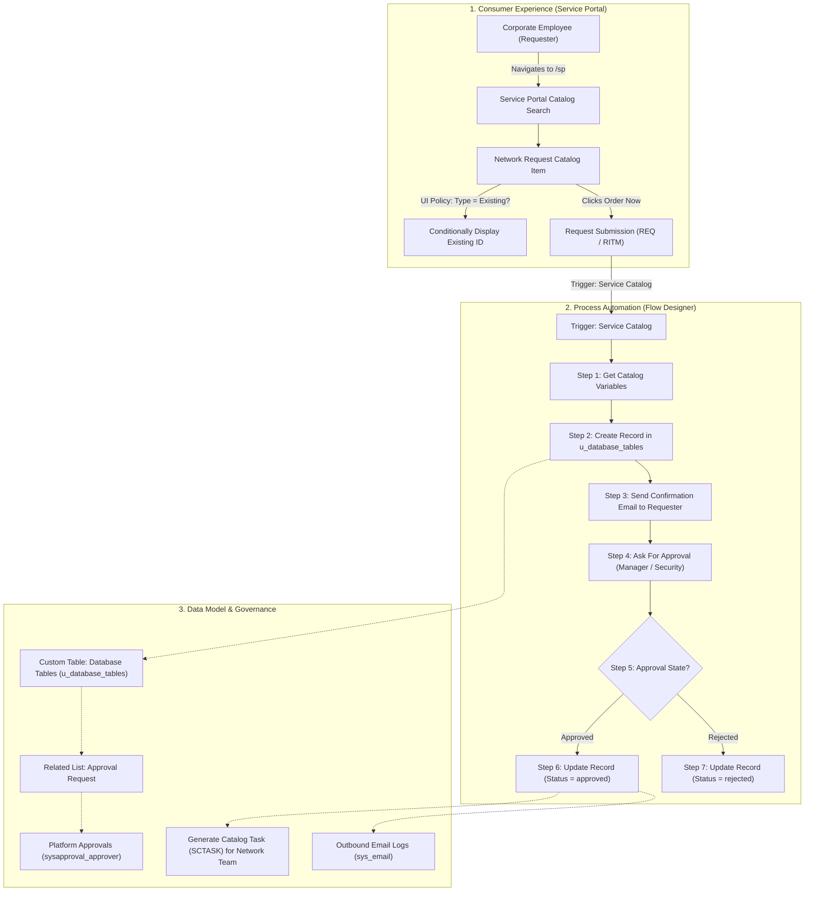

# Automated Network Request Management in ServiceNow

[](https://www.servicenow.com)
[](https://docs.servicenow.com)
[]()
[](Project_Documents/)

---

## 📋 Executive Summary & Business Objective

In enterprise IT ecosystems, managing network requests—such as switch port allocation, VLAN provisioning, IP assignments, firewall policy modifications, and connectivity setups—manually leads to human error, configuration discrepancies, and protracted fulfillment cycles.

The **Automated Network Request Management** solution streamlines and automates the end-to-end lifecycle of network-related service requests natively on the **ServiceNow platform**, achieving:

- ⚡ **Accelerated Request Turnaround:** Reduces request fulfillment times from multiple business days to standard SLA delivery within 48 hours.
- 🎯 **Elimination of Human Error:** Standardizes data intake with client-side UI policies and mandatory server-side constraints.
- 🛡️ **Enforced Governance & Approvals:** Automatically routes requests to department managers and network security leads with dynamic approval logic.
- 👁️ **Unified Visibility & Auditability:** Centralizes request data into a custom transactional table (`u_database_tables`) with complete audit trails and related approval lists.
- 📱 **Modern Self-Service Experience:** Empowers enterprise employees to submit network requests seamlessly via the ServiceNow **Service Portal** (`/sp`).

---

## 📑 Project Phase Documents Directory

As per enterprise project delivery standards, this repository contains **4 comprehensive Phase Documents** stored in the dedicated [`Project_Documents/`](Project_Documents/) folder, available in both **PDF** and **Markdown** formats:

| Phase Document | Format | Scope & Core Deliverables | Direct Links |
| :--- | :---: | :--- | :--- |
| **Phase 1: Ideation Phase** | `PDF` / `MD` | Business objectives, operational challenges, stakeholder impact matrix, scope boundaries, and target KPIs. | [📄 Phase_1_Ideation_Phase.pdf](Project_Documents/Phase_1_Ideation_Phase.pdf)<br>[📝 Phase_1_Ideation_Phase.md](Project_Documents/Phase_1_Ideation_Phase.md) |
| **Phase 2: Project Design Phase** | `PDF` / `MD` | System architecture, `u_database_tables` schema, Approval Request relationship, Catalog Item, Variable Sets, and Dynamic UI Policies. | [📄 Phase_2_Project_Design_Phase.pdf](Project_Documents/Phase_2_Project_Design_Phase.pdf)<br>[📝 Phase_2_Project_Design_Phase.md](Project_Documents/Phase_2_Project_Design_Phase.md) |
| **Phase 3: Project Planning Phase** | `PDF` / `MD` | 5-Phase WBS roadmap, RACI matrix, risk assessment, QA test strategy, and step-by-step PDI replication manual. | [📄 Phase_3_Project_Planning_Phase.pdf](Project_Documents/Phase_3_Project_Planning_Phase.pdf)<br>[📝 Phase_3_Project_Planning_Phase.md](Project_Documents/Phase_3_Project_Planning_Phase.md) |
| **Phase 4: Project Development Phase** | `PDF` / `MD` | Flow Designer orchestration build, Service Portal live testing, ACL security enforcement, execution logs, and email outbox audit. | [📄 Phase_4_Project_Development_Phase.pdf](Project_Documents/Phase_4_Project_Development_Phase.pdf)<br>[📝 Phase_4_Project_Development_Phase.md](Project_Documents/Phase_4_Project_Development_Phase.md) |

---

## 🏛️ End-to-End System Architecture

The solution utilizes a modular platform architecture that connects the self-service consumer layer to backend transactional databases, approval engines, and notification dispatchers:



---

## 👥 Stakeholder Matrix & Impact Analysis

| Stakeholder | Role in Project | Current Operational Pain Points | Needs & Expectations | Impact of Automation |
| :--- | :--- | :--- | :--- | :--- |
| **End Users (Requesters)** | Employees requesting network access or hardware changes | Incomplete forms, lack of status visibility, endless email chains | Intuitive submission, fast turnaround, real-time tracking | ✔️ Fast self-service via Service Portal<br>✔️ Instant automated email updates<br>✔️ 70% faster delivery |
| **IT Administrators** | Platform architects and system maintainers | Disparate business rules, unmaintainable scripts, high ticket load | Out-of-the-box flow logic, clean data models, low maintenance | ✔️ 100% no-code Flow Designer logic<br>✔️ Standardized table schema<br>✔️ Simplified release upgrades |
| **Network Fulfillment Team** | Engineers executing network infrastructure changes | Missing technical requirements, chasing requesters for details | Accurate data intake, automated task dispatch, standard queues | ✔️ Automated task and record generation<br>✔️ Zero missing requirements<br>✔️ More time for complex issues |
| **Approvers** | Department managers and network security leads | Email approval requests getting buried, lack of business context | Clear request details, single-click approvals, compliance | ✔️ Structured approval routing<br>✔️ Immutable audit logging<br>✔️ Fast turnaround |

---

## 🗄️ Custom Data Model: `u_database_tables`

To avoid cluttering default platform tables while maintaining strict audit compliance, requests are persisted in a custom table labeled **Database Tables** (`u_database_tables`):

### Table Schema & Field Dictionary

| Column Label | Element Name | Data Type | Length | Default / Logic Specification |
| :--- | :--- | :--- | :---: | :--- |
| **Number** | `u_number` | String | 40 | `javascript:global.getNextObjNumberPadded();` |
| **Database Number** | `u_database_number` | String | 32 | Reference / Unique identifier |
| **Requested For** | `u_requested_for` | Reference (`sys_user`) | 32 | Automatically binds to session user |
| **Assignment to** | `u_assignment_to` | Reference (`sys_user`) | 32 | Assigned network fulfiller / ITIL user |
| **Mobile Number** | `u_mobile_number` | String | 40 | Contact mobile telephone number |
| **Type of Connection** | `u_type_of_connection` | Choice / String | 40 | Choices: `NEW`, `EXISTING` |
| **Total Amount** | `u_total_amount` | String / Decimal | 32 | Financial billing amount |
| **Mode of Payment** | `u_mode_of_payment` | Choice / String | 40 | Choices: `UPI`, `online` |
| **Customer Address** | `u_customer_address` | String | 40 | Delivery location / office address |
| **Approval Status** | `u_approval_status` | Choice / String | 40 | Choices: `approved`, `waiting for approval`, `rejected` |

### Visual Implementation: Table & Schema Definitions

| Tables Registry (`sys_db_object_list`) | Table Definition Form (`sys_db_object`) |
| :---: | :---: |
|  |  |
| *Figure 1: Custom Table registered in ServiceNow* | *Figure 2: Table Configuration in Global Scope* |

| Table Columns & Dictionary Entries | Record Creation Form Layout |
| :---: | :---: |
|  |  |
| *Figure 3: Dictionary Entries with Auto-Numbering* | *Figure 4: Empty Form Layout for Database Tables* |

| Populated Test Network Record |
| :---: |
|  |
| *Figure 5: Test Record RITM0001004 / 123456789 with Populated Fields* |

---

## 🔗 Approval Request Relationship & Related Lists

To display approvals directly on the `u_database_tables` record view, a platform Relationship was created linking the custom table to the native platform approvals table (`sysapproval_approver`):

- **Relationship Name:** `Approval Request`
- **Applies to Table:** `Database Tables [u_database_tables]`
- **Queries from Table:** `Approvals [sysapproval_approver]`
- **Relationship Query Script:**
  ```javascript
  current.addQuery("sysapproval", parent.sys_id);
  ```

| Relationships Registry | Approval Request Form Configuration |
| :---: | :---: |
|  |  |
| *Figure 6: System Definition > Relationships List* | *Figure 7: Approval Request Relationship Properties* |

| Query Condition Configuration Script |
| :---: |
|  |
| *Figure 8: Query Script linking sysapproval_approver to parent record* |

---

## 🛍️ Service Catalog Design & Dynamic UI Policies

### 1. Catalog Item Configuration: "Network Request"
- **Item Name:** `Network Request`
- **Catalog:** `Service Catalog`
- **Category:** `Standard Changes / Network Services`
- **Short Description:** `Network request Management`
- **Process Engine Binding:** Bound to Flow `Network Requests`

| Catalog Items Search | Network Request Registry Item |
| :---: | :---: |
|  |  |
| *Figure 9: Service Catalog Items Search* | *Figure 10: Network Request in Active Catalog List* |

| Catalog Item Header & Settings | Process Engine & Flow Binding |
| :---: | :---: |
|  |  |
| *Figure 11: Network Request Form Settings* | *Figure 12: Bound to 'Network Requests' Flow* |

### 2. Variable Set: "Request Information"
A reusable single-row variable set encapsulates all required ordering fields:

| Variable Set Definition |
| :---: |
|  |
| *Figure 13: Variable Set 'Request Information' containing user, contact, and network parameters* |

### 3. Dynamic Catalog UI Policy: `visible/hide of ID field`
Enforces dynamic client-side field behavior based on requester choice:
- **Condition:** `Type of Connection is EXISTING`
- **Action:** Set variable `Existing ID` to **Visible: True**
- **Settings:** `On load = True`, `Reverse if false = True`

| Catalog UI Policies Related List | UI Policy Condition Configuration |
| :---: | :---: |
|  |  |
| *Figure 14: UI Policies listed on Catalog Item* | *Figure 15: Condition: Type of Connection is EXISTING* |

| UI Policy Action Target Variable | UI Policy Settings & Execution Properties |
| :---: | :---: |
|  |  |
| *Figure 16: Action Target: Existing ID Visible = True* | *Figure 17: Applies on Load = True, Reverse if False = True* |

---

## ⚡ Flow Designer Automation Engine

The entire backend automation was created in **ServiceNow Flow Designer** (Workflow Studio) without writing custom code or maintenance-heavy business rules:

### Automated Steps Breakdown

1. **Trigger:** `Service Catalog` (Fires automatically upon Catalog Item submission).
2. **Action 1: Get Catalog Variables:** Extracts submitted variables from the triggering `Requested Item` for `Network Request`.
3. **Action 2: Create Record:** Inserts a new record into `u_database_tables`, mapping variables (`Requested For`, `Mobile Number`, `Type of Connection`, `Total Amount`, `Mode of Payment`).
4. **Action 3: Send Email:** Dispatches an automated confirmation email to the requester with request details.
5. **Action 4: Ask For Approval:** Generates approval request on the created `u_database_tables` record (Rule: *Anyone approves* from Manager / Network Approvers).
6. **Flow Logic 5 (IF):** Evaluates if Approval State is `Approved`.
   - **Action 6: Update Record:** Sets `Approval Status` on `u_database_tables` to `approved`.
7. **Flow Logic 7 (ELSE):** Handles rejection branch.
   - **Action 8: Update Record:** Sets `Approval Status` to `rejected`.

### Visual Implementation: Flow Designer Pipeline

| Workflow Studio Homepage | Flow Trigger: Service Catalog |
| :---: | :---: |
|  |  |
| *Figure 18: Workflow Studio Flow Registry* | *Figure 19: Trigger on Service Catalog Item* |

| Action 1: Get Catalog Variables | Action 2: Create Record in Database Tables |
| :---: | :---: |
|  |  |
| *Figure 20: Extracting Variables from RITM* | *Figure 21: Mapping Data Pills to u_database_tables* |

| Action 3: Send Email Confirmation | Action 4: Ask For Approval |
| :---: | :---: |
|  |  |
| *Figure 22: Outbound Email Notification Configuration* | *Figure 23: Routing Approval to Designated Approver* |

| Flow Logic 5: IF Condition on Approval | Action 6: Update Record to Approved |
| :---: | :---: |
|  |  |
| *Figure 24: Checking Approval State == Approved* | *Figure 25: Updating Database Record Status to 'approved'* |

| Flow Logic 7: ELSE Rejection Branch | Complete Active Flow Pipeline |
| :---: | :---: |
|  |  |
| *Figure 26: Else Condition for Rejection Path* | *Figure 27: Full Active Flow Pipeline in Workflow Studio* |

---

## 🖥️ Service Portal End-to-End User Experience

The complete request lifecycle was executed and verified on the ServiceNow **Service Portal** (`/sp`):

1. **Navigation:** User accesses portal at `https://dev353842.service-now.com/sp`.
2. **Search & Discovery:** User types `network request` into catalog search.
3. **Form Completion:** User fills parameters (Requester: `satya`, User: `anusri`, Mobile: `7816006060`, Connection: `NEW`, Payment: `UPI`).
4. **Order Confirmation:** Submits request through the order modal dialog.
5. **Request Generation:** System generates Request **REQ0010003** with Delivery Stage **Request Approval**.

| Service Portal Homepage (`/sp`) | Catalog Search & Discovery |
| :---: | :---: |
|  |  |
| *Figure 28: Modern Service Portal Landing Page* | *Figure 29: Searching for Network Request Item* |

| Dynamic Form Completion on Portal | Order Confirmation Modal |
| :---: | :---: |
|  |  |
| *Figure 30: Populating Network Request Form Parameters* | *Figure 31: Order Confirmation & Submission ('Submitting...')* |

| Request Summary & Stage Tracking (REQ0010003) |
| :---: |
|  |
| *Figure 32: Order confirmation showing Request REQ0010003 in Stage 'Request Approval'* |

---

## ✉️ System Logs & Outbound Email Verification

Following live submission `REQ0010003`, ServiceNow System Logs (`sys_email_list.do`) were inspected to verify email notification triggers:

- **Email Type:** `send-ready`
- **Notification Type:** `SMTP`
- **Dispatched Notifications:**
  - `Request REQ0010003 was created`
  - `Request REQ0010003 was approved`
  - `Catalog Task SCTASK0010006 has been assigned to group Software`

| System Logs > Emails List (`sys_email_list.do`) | Detailed Approval Email Record (`sys_email.do`) |
| :---: | :---: |
|  |  |
| *Figure 33: Outbox logs showing send-ready notifications* | *Figure 34: Detailed approved email record with HTML payload* |

---

## 🔒 Security & Access Control Lists (ACLs)

Platform security on `u_database_tables` complies with ITIL least-privilege standards:

| Access Operation | Target Table / Field | Granted Roles | Governance Rule |
| :--- | :--- | :--- | :--- |
| **Create** | `u_database_tables` | `itil`, `snc_internal` | Created automatically by Flow Designer engine upon catalog order |
| **Read** | `u_database_tables.*` | `itil`, `requester` (dynamic) | Requesters can inspect own records; Network team inspects queue |
| **Write** | `u_database_tables.*` | `itil`, `admin` | Network engineers update fulfillment fields; Requesters cannot tamper |
| **Delete** | `u_database_tables` | `admin` | Restricted to system administrators to preserve immutable audit trail |

---

## 🚀 Step-by-Step PDI Replication Manual

Follow these steps to replicate this solution in any Personal Developer Instance (PDI):

### Step 1: Create Custom Table
1. Navigate to **System Definition > Tables** and click **New**.
2. Label: `Database Tables`, Name: `u_database_tables`.
3. Add fields: `u_number`, `u_database_number`, `u_assignment_to`, `u_mobile_number`, `u_total_amount`, `u_mode_of_payment`, `u_type_of_connection`, `u_customer_address`, `u_approval_status`, `u_requested_for`.

### Step 2: Configure Approval Request Relationship
1. Navigate to **System Definition > Relationships** and click **New**.
2. Name: `Approval Request`.
3. Applies to Table: `Database Tables [u_database_tables]`.
4. Queries from Table: `Approvals [sysapproval_approver]`.
5. Script:
   ```javascript
   current.addQuery("sysapproval", parent.sys_id);
   ```
6. Add Related List `Approval Request` to the `u_database_tables` form layout.

### Step 3: Create Service Catalog Item & Variable Set
1. Navigate to **Service Catalog > Catalog Items** and click **New**.
2. Name: `Network Request`, Catalogs: `Service Catalog`, Category: `Standard Changes`.
3. Create Variable Set `Request Information` with variables:
   - `opened_on_behalf_of`
   - `user_name`
   - `mobile_number`
   - `type_of_connection` (Choices: `NEW`, `EXISTING`)
   - `existing_id`
   - `total_amount`
   - `mode_of_payment`
   - `email_id`
   - `phone_number`

### Step 4: Configure Catalog UI Policy
1. On `Network Request`, navigate to **Catalog UI Policies** and click **New**.
2. Condition: `Type of Connection is EXISTING`.
3. In Related List **Catalog UI Policy Actions**, add `Existing ID` with **Visible: True**.
4. Set **Reverse if false: True** and **On load: True**.

### Step 5: Build Flow Designer Automation
1. Open **Workflow Studio > Flows > New Flow** named `Network Requests`.
2. **Trigger:** `Application > Service Catalog`.
3. **Action 1:** `Service Catalog > Get Catalog Variables` (From Trigger RITM).
4. **Action 2:** `ServiceNow Core > Create Record` in `u_database_tables` (Map variables).
5. **Action 3:** `ServiceNow Core > Send Email` (Confirmation).
6. **Action 4:** `ServiceNow Core > Ask For Approval` on `u_database_tables` record.
7. **Flow Logic:** `IF Approval State is Approved` ➔ `Update Record` (`approval_status = approved`).
8. **Flow Logic:** `ELSE` ➔ `Update Record` (`approval_status = rejected`).
9. **Save & Activate Flow**.

### Step 6: Test on Service Portal
1. Navigate to `https://<instance>.service-now.com/sp`.
2. Search and order `Network Request`. Verify UI policy dynamic field toggling.
3. Check `sys_email_list.do` and `u_database_tables.list` for verified record and approval state.

---

## 🔮 Future Enhancements & Integration Roadmap

1. **Zero-Touch Physical Network Provisioning:** Integration with **Cisco DNA Center** and **Ansible Tower** via ServiceNow **Integration Hub** spokes for automatic switch port VLAN assignment and ACL application.
2. **Automated Firewall Rule Changes:** Direct integration with Palo Alto Networks / Check Point APIs for automated security policy pushes upon managerial approval.
3. **Executive Performance Analytics:** Real-time dashboards visualizing fulfillment velocity, request volume trends, and SLA compliance metrics.

---

## 📄 License & Confidentiality
*This project documentation and configuration artifacts are prepared for internal enterprise IT Service Management and audit compliance.*
